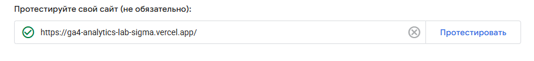
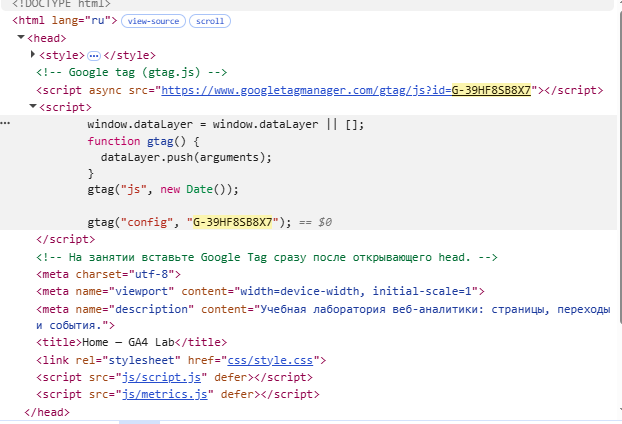
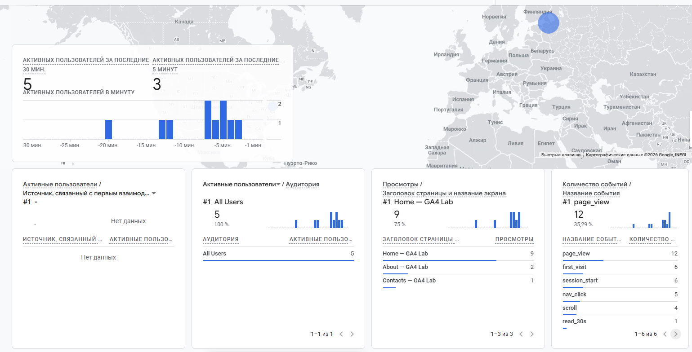
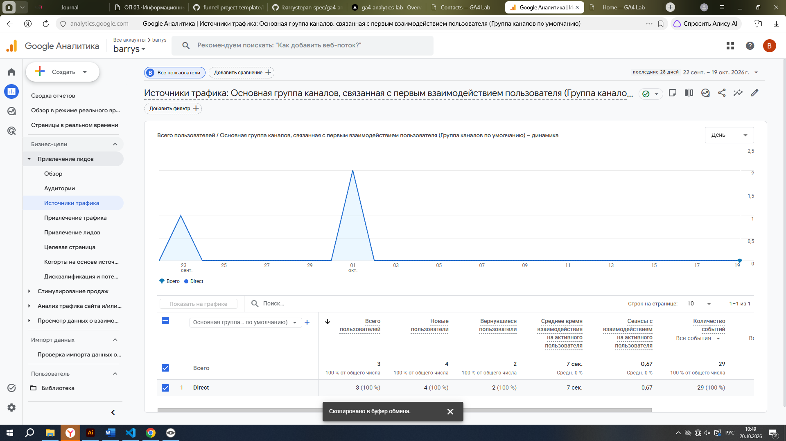
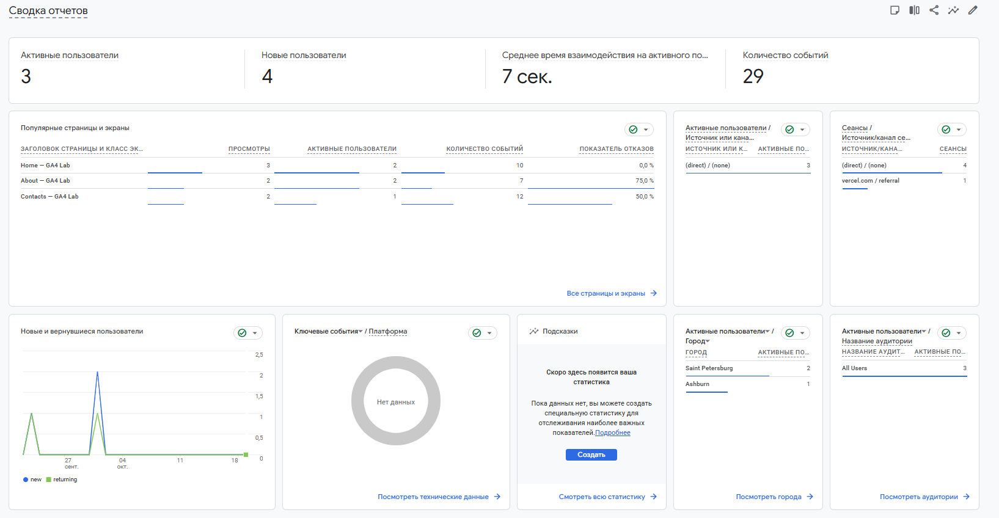

# Домашняя работа № 3 · Тег на сайте, источник и отчёты GA4

**Дисциплина:** ОП.03 «Информационные технологии»

| Поле | Значение |
|---|---|
| Фамилия, имя, отчество | Балан Степан Александрович |
| Группа | 9/2-РПО-25/1 |
| Номер работы | 3 |
| Тема работы | Установка Google Tag, источник перехода и отчёты GA4 |
| Дата сдачи | 20.10.2026 |
| Ветка | `hw-03` |

---

## 1. Мой сайт и мой ресурс

| Поле | Значение |
|---|---|
| Адрес репозитория сайта | https://github.com/barrystepan-spec/ga4-analytics-lab |
| Публичный адрес сайта | https://ga4-analytics-lab-sigma.vercel.app/ |
| Статус публикации | READY |
| Analytics Account | barrys |
| Property | barrys |
| Stream name | ga4 analytics lab |
| Website URL в потоке | https://ga4-analytics-lab-sigma.vercel.app/ |
| Measurement ID (`G-…`) | G-39HF8SB8X7 |
| Страницы с тегом | index.html, about.html, contacts.html |

Тег ставится на каждую страницу по одному разу: две копии дают двойные события.

## 2. Тег установлен

**Результат проверки из инструкции тега:**

> Тег обнаружен.

Скриншот: 

Скриншот: 

## 3. События доходят до аналитики

| Поле | Значение |
|---|---|
| Дата и время проверки | 20.10.2026, 10:45 |
| Какие страницы открывали | Home, About, Contacts |
| Какие события появились в Realtime | page_view, first_visit, session_start, nav_click, scroll, read_30s |
| Число активных пользователей в момент проверки | 5 |

Скриншот: 

## 4. Источник перехода определился

Ссылка собирается с метками `utm_source`, `utm_medium`, `utm_campaign` и открывается на своём сайте.

**Ссылка целиком:**

```
https://ga4-analytics-lab-sigma.vercel.app/?utm_source=homework&utm_medium=test&utm_campaign=hw03
```

| Поле | Значение |
|---|---|
| Где в GA4 виден источник | Отчёты → Привлечение → Источники трафика |
| Какое значение источника показал GA4 | Direct |
| Совпадает с `utm_source` из ссылки | нет |

Скриншот: 

Источник и кампания из UTM в отчёте Realtime не показываются: эти измерения вычисляются при обработке данных. Если в Realtime источника нет, смотрите отчёт по источникам трафика в разделе «Отчёты».

## 5. Статистика на странице «Отчёты»

| Показатель | Значение | Период |
|---|---|---|
| Пользователи | 3 (активные) / 4 (новые) | Текущий период |
| Сеансы | 5 | Текущий период |
| События | 29 | Текущий период |
| Самое частое событие | page_view | Текущий период |

Скриншот: 

**Что видно по этим числам** (2–3 предложения):

> На сайте зафиксировано 3 активных и 4 новых пользователя, а также 29 событий. Большая часть событий приходится на просмотры страниц (page_view). Среднее время взаимодействия небольшое (7 секунд), что типично для учебных проверок и коротких сессий.

## 6. Что не получилось

Если какой-то шаг не заработал, напишите какой, какое сообщение показал сервис и что было проверено по таблице из `README.md`. Незаполненный раздел означает, что всё получилось.

> Источник перехода по UTM-меткам определился как Direct. Возможно, данные ещё обрабатываются или сессия была продолжена. Остальные шаги (установка тега, события в Realtime, отчёты) выполнены успешно.

## 7. Использование ИИ

Тег вы устанавливаете, проверяете и снимаете кадры сами. ИИ допускается для формулировок и оформления.

| Вопрос | Ответ |
|---|---|
| Что сделано самостоятельно | Создал аккаунт и поток в GA4, установил тег на все страницы сайта, опубликовал на Vercel, проверил события в Realtime, сделал все скриншоты |
| Что спрошено у модели | Попросил помочь с формулировками разделов отчёта и структурой заполнения |
| Что после этого изменено | Проверил все данные, вставил свои скриншоты и цифры |
```