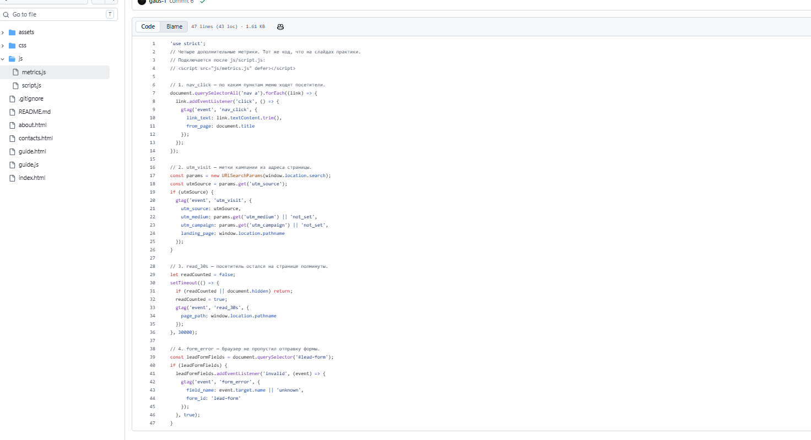
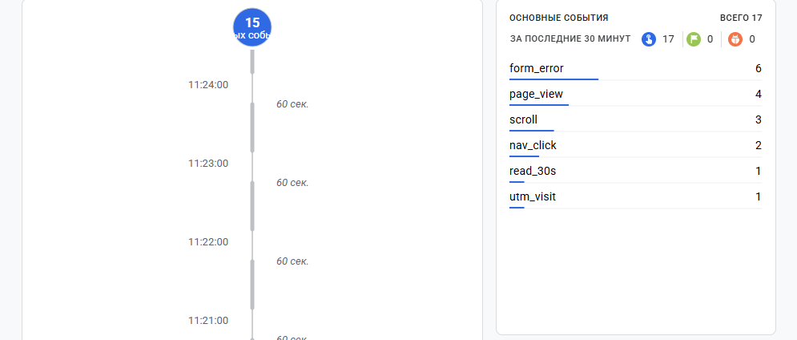
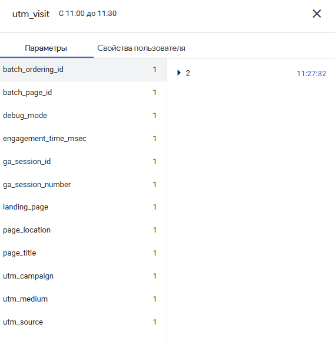
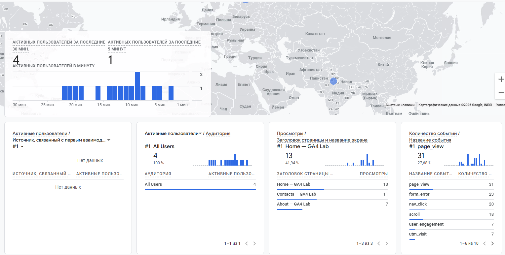

# Задание 4 · Свои события и параметры в GA4

**Дисциплина:** ОП.03 «Информационные технологии»

| Поле | Значение |
|---|---|
| Фамилия, имя, отчество | Балан Степан Александрович |
| Группа | 9/2-РПО-25/1 |
| Номер работы | 4 |
| Тема работы | Свои события и параметры в GA4 |
| Дата сдачи | 20.10.2026 |
| Коммит | `hw-04` |

---

## 1. Мой сайт и ресурс GA4

| Поле | Значение |
|---|---|
| Адрес репозитория | https://github.com/barrystepan-spec/ga4-analytics-lab |
| Публичный адрес сайта | https://ga4-analytics-lab-sigma.vercel.app/ |
| Measurement ID | G-39HF8SB8X7 |
| Analytics Account | barrys |
| Property | barrys |
| Stream name | ga4 analytics lab |

---

## 2. Метрики добавлены в проект

Добавлены четыре события из файла `js/metrics.js`:

| Событие     | Что измеряет                             |
|-------------|------------------------------------------|
| nav_click   | по каким пунктам меню ходят посетители   |
| utm_visit   | метки кампании из адреса страницы        |
| read_30s    | посетитель остался на странице полминуты |
| form_error  | браузер не пропустил отправку формы      |

Файл подключён на всех страницах после основного скрипта:

```html
<script src="js/script.js" defer></script>
<script src="js/metrics.js" defer></script>
```

Скриншот: 

---

## 3. События доходят до аналитики (DebugView / Realtime)

После действий на сайте в аналитике зафиксированы события:

- `form_error` — 6
- `page_view` — 4
- `scroll` — 3
- `nav_click` — 2
- `read_30s` — 1
- `utm_visit` — 1

Скриншот: 

---

## 4. Параметры события utm_visit

Сайт открыт по ссылке:

```
https://ga4-analytics-lab-sigma.vercel.app/?utm_source=telegram&utm_medium=social&utm_campaign=ga4_lab
```

В параметрах события `utm_visit` присутствуют:

- `utm_source`
- `utm_medium`
- `utm_campaign`
- `landing_page`
- и другие служебные параметры

Скриншот: 

---

## 5. Событие видно не только в отладке

События отображаются в Realtime. За последние 30 минут видно:

- `page_view` — 31
- `form_error` — 23
- `nav_click` — 20
- `scroll` — 18
- `utm_visit` — 7
- и другие

Скриншот: 

---

## 6. Что не получилось

> Всё получилось. Все четыре метрики работают, события и параметры доходят до GA4.

---

## 7. Использование ИИ

| Вопрос | Ответ |
|---|---|
| Что сделано самостоятельно | Проверил наличие и код файла metrics.js, выполнил действия на сайте (клики по меню, ожидание 30 секунд, отправка пустой формы), открыл сайт с UTM-метками, сделал все скриншоты |
| Что спрошено у модели | Попросил помощь с включением DebugView и оформлением бланка отчёта |
| Что после этого изменено | Проверил появление событий и параметров, вставил свои скриншоты |
```
