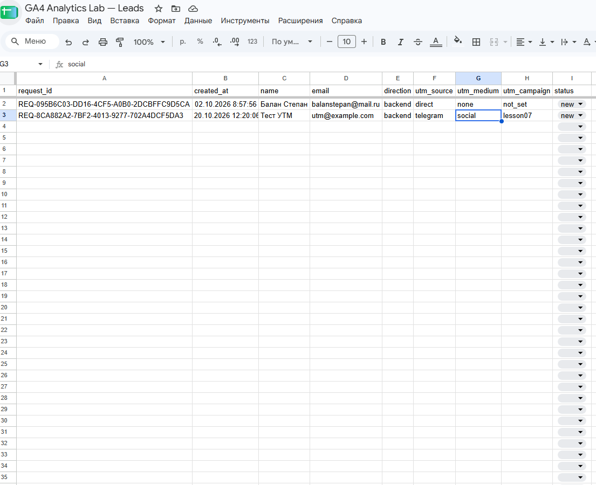
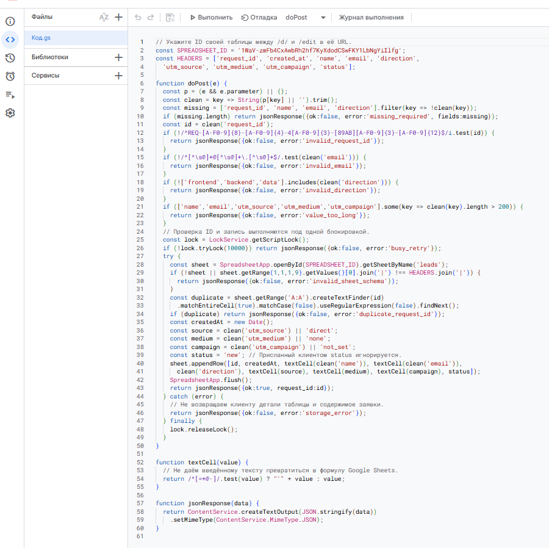
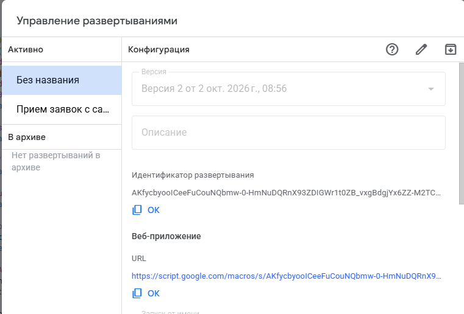
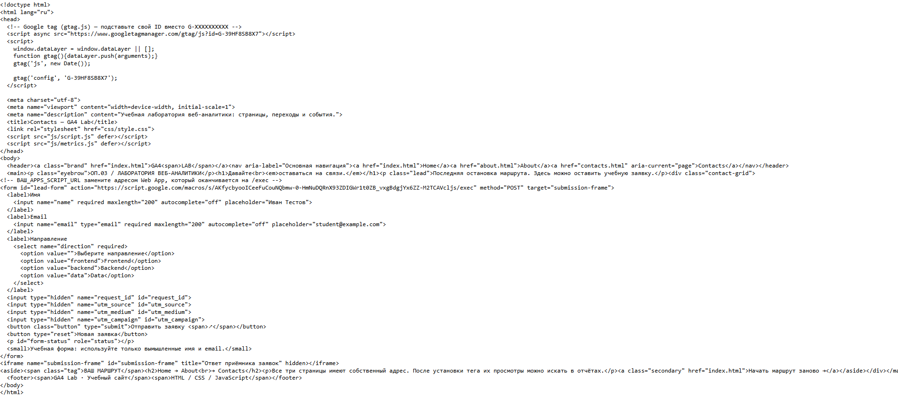
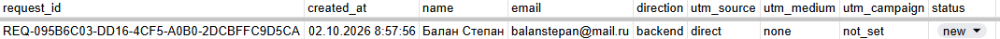
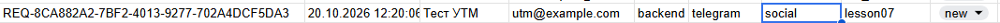
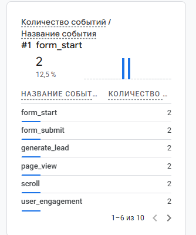
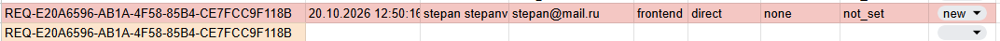
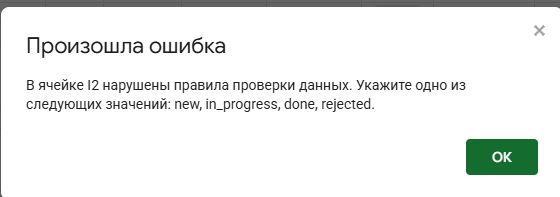

# Задание 5 · Контролируемая таблица заявок

**Дисциплина:** ОП.03 «Информационные технологии»

```
| Поле                   | Значение                                      |
| ---------------------- | --------------------------------------------- |
| Фамилия, имя, отчество | Балан Степан Александрович                    |
| Группа                 | 9/2-РПО-25/1                                  |
| Номер работы           | 5                                             |
| Тема работы            | Контролируемая таблица заявок                 |
| Дата сдачи             | 20.10.2026                                    |
| Коммит                 | `hw-05`                                       |
```

---

## 1. Мой сайт, таблица и приёмник

```
| Поле                      | Значение                                                                 |
| ------------------------- | ------------------------------------------------------------------------ |
| Адрес репозитория         | https://github.com/barrystepan-spec/ga4-analytics-lab                    |
| Публичный адрес сайта     | https://ga4-analytics-lab-sigma.vercel.app/                              |
| Страница формы            | https://ga4-analytics-lab-sigma.vercel.app/contacts.html                 |
| Measurement ID            | G-39HF8SB8X7                                                             |
| Таблица Google Sheets     | https://docs.google.com/spreadsheets/d/1WvJ-zmfB4CxAwBth2nF7WyXkodCSwFKYiLDmgYiIfg/edit |
| SPREADSHEET_ID            | 1WvJ-zmfB4CxAwBth2nF7WyXkodCSwFKYiLDmgYiIfg                             |
| Apps Script Web App       | https://script.google.com/macros/s/AKfycbyoolCeeFuCouNQbmw-0-HmNuDQRnX93ZDIGWr1t0ZB_vxgBdgjYx6ZZ-M2TCAVcljS/exec |
```

Доступ к таблице открыт только преподавателю (роль «Читатель»). Доступ «всем, у кого есть ссылка» не открывался.

---

## 2. Таблица устроена по правилам

Лист `leads` в документе **GA4 Analytics Lab — Leads**:

- девять заголовков: `request_id`, `created_at`, `name`, `email`, `direction`, `utm_source`, `utm_medium`, `utm_campaign`, `status`
- первая строка закреплена
- столбец `status` — список значений: `new`, `in_progress`, `done`, `rejected`
- два правила: подсветка дубля `request_id` и проверка данных для статуса

Скриншот: 

---

## 3. Приёмник Apps Script опубликован

В `Code.gs` указан ID таблицы:

```js
const SPREADSHEET_ID = '1WvJ-zmfB4CxAwBth2nF7WyXkodCSwFKYiLDmgYiIfg';
```

Проект опубликован как Web application. URL заканчивается на `/exec`.

Скриншоты:  
  


---

## 4. Форма отправляет заявку в приёмник

В `contacts.html`:

- `action` формы указывает на адрес Web App с `/exec`
- есть скрытые поля `request_id`, `utm_source`, `utm_medium`, `utm_campaign`
- обработчик формы в `js/script.js` заменён на версию из материалов темы 7
- изменения опубликованы (Deployment = Ready)

Скриншот: 

---

## 5. Заявка без меток записалась

Отправлена форма без UTM в адресе страницы.

| Поле | Значение |
| --- | --- |
| request_id | `REQ-095B6C03-DD16-4CF5-A0B0-2DCBFFC9D5CA` |
| created_at | 02.10.2026 8:57:56 |
| name | Балан Степан |
| email | balanstepan@mail.ru |
| direction | backend |
| utm_source | direct |
| utm_medium | none |
| utm_campaign | not_set |
| status | new |

Скриншот: 

---

## 6. Метки доехали до таблицы

Сайт открыт по ссылке:

```
https://ga4-analytics-lab-sigma.vercel.app/contacts.html?utm_source=telegram&utm_medium=social&utm_campaign=lesson07
```

| Поле | Значение |
| --- | --- |
| request_id | `REQ-8CA882A2-7BF2-4013-9277-702A4DCF5DA3` |
| created_at | 20.10.2026 12:20:0… |
| name | Тест UTM |
| email | utm@example.com |
| direction | backend |
| utm_source | telegram |
| utm_medium | social |
| utm_campaign | lesson07 |
| status | new |

Скриншот: 

---

## 7. Аналитика видит попытку отправки

В Realtime / DebugView зафиксировано событие `generate_lead` (количество = 2).

Скриншот: 

---

## 8. Таблица отмечает ошибки

### Дубль request_id

Повторная отправка с тем же `request_id` не создаёт новую строку. В таблице подсвечена строка:

`REQ-E20A6596-AB1A-4F58-85B4-CE7FCC9F118B`

Скриншот: 

### Неверный статус

При попытке ввести значение статуса, которого нет в списке, появляется сообщение:

> В ячейке I2 нарушены правила проверки данных. Укажите одно из следующих значений: new, in_progress, done, rejected.

Скриншот: 

---

## 9. Что не получилось

> Всё получилось. Таблица настроена, приёмник опубликован, обе заявки записались, метки на месте, `generate_lead` виден в аналитике, дубль и неверный статус пойманы.

---

## 10. Использование ИИ

```
| Вопрос                     | Ответ                                                                                                                                 |
| -------------------------- | ------------------------------------------------------------------------------------------------------------------------------------- |
| Что сделано самостоятельно | Создал таблицу, настроил список статусов и условное форматирование, вставил Code.gs, опубликовал Web App, обновил форму и script.js, отправил две заявки, сделал все скриншоты |
| Что спрошено у модели      | Попросил помощь с оформлением бланка homework_05.md в формате предыдущей работы                                                       |
| Что после этого изменено   | Проверил совпадение request_id и адресов со скриншотами, вставил свои данные в бланк                                                  |
```
